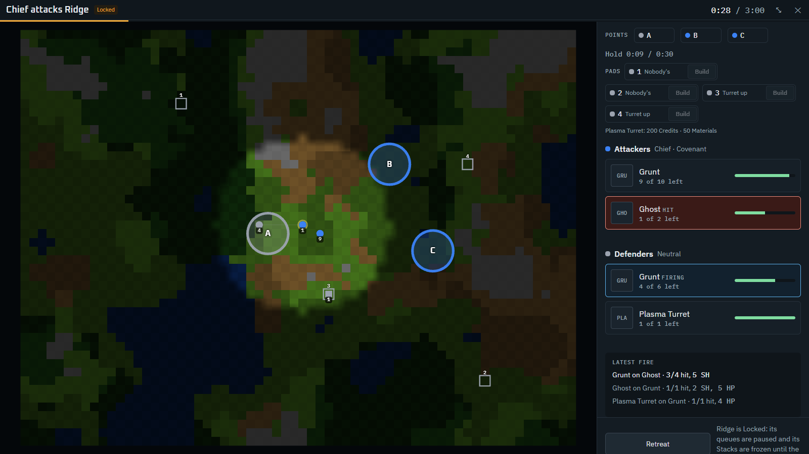

# Halo Battles: tactical Battle spec

How a Battle plays out on a 2D top-down Battlefield. It replaces the round-based resolver described in earlier versions of the [game-design spec](game-design-spec.md#battles). Terms follow [GLOSSARY.md](../../GLOSSARY.md). Decisions: [ADR 0004](../adr/0004-real-time-battle-sim.md) (real-time sim) and [ADR 0005](../adr/0005-ai-as-controller.md) (AI as a Controller).

Everything about a Battle **before it starts** (who fights, Locking, waiting Armies) and **after it ends** (capture, Retreat, survivors) stays as written in the game-design spec. This spec covers what happens between those two points.

Every number below is Ruleset or content data. The values given are base-Mod defaults and **first-pass numbers meant to be tuned in playtests**.

## Overview

- A Battle is a **real-time, server-authoritative simulation** on a square-grid **Battlefield** generated for its Planet. The two sides watch it live in the Battle window, which can go full-screen.
- Each Unit Slot fights as one or more **Squad** tokens. Squads move, take cover, hold high ground and fight over **Landing Zones**, and the attacker goes for the defender's **Command Post**. It is not a fight to the death.
- Both sides are run by **Controllers**. In v1 every Controller is the AI, and the only order a player gives is **Retreat**. The AI issues the same orders a player will later, so player control can be added without changing the sim.
- **Fog of war:** a side sees enemy units only within its Sight.
- The damage model is unchanged: Shield → Armor → HP layers, Weapon Types, the To-hit roll, Damage rolls and tiers ([ADR 0003](../adr/0003-dice-damage.md)). Position and terrain change **who can hit whom and how easily**, never how damage is worked out.

## Battlefield

### Size and seed

- The default size is **64 × 48 cells**. A Planet can set its own `battlefield.width` and `battlefield.height`.
- A Battlefield is generated from **the Match seed + the Planet id**, and the **defending Faction**, whose base it holds (a neutral garrison's base when nobody owns the Planet). The ground is the same for the whole Match, so players can learn it; whoever defends shows their own base on it. Each is generated on the Planet's first Battle with that defender, and cached for the Match.
- The client never generates terrain. `BattleStarted` carries the finished grid (see [On the wire](#on-the-wire)).

### Generation

Generation follows [Red Blob Games: terrain from noise](https://www.redblobgames.com/maps/terrain-from-noise/):

1. **Elevation** and **moisture** are two independent noise fields. Each is a sum of octaves, with frequency doubling and amplitude scaled by `persistence` per octave.
2. Each field is **ranked**: a cell's value becomes its rank as a share of the map's cells. A preset's thresholds are therefore shares of the map, so `upTo: 0.12` on the lowest band makes 12% of cells water.
3. Elevation is cut into **bands**, lowest first. The base presets use `water`, `lowland`, `highland` and `peak`, and each band sets its height level.
4. Moisture splits each band into Terrains, driest first. For example, lowland comes out as rough, open or forest.
5. A **Terrain Preset** supplies the noise parameters, the bands, and the Terrains in each. A desert Planet comes out mostly sand and rough; an ice Planet turns its lakes into ice you can walk on. A Planet names its preset in `battlefield.terrainPreset`; otherwise the Ruleset's `battlefield.terrainPreset` applies.
6. **Archetype** (#99): a [Battlefield Archetype](#archetypes-and-fixtures) shapes the map, picked by the preset's `archetypes` weights or forced by the Planet's `battlefield.archetype`, along with the **defender's edge**:
   - **open:** the noise as it is;
   - **river:** a band across the attack sunk to the lowest band (water, or ice), with 2 or 3 fords cleared 3 cells wide;
   - **ridge:** the line of the attack raised to high ground, or (a valley) the ground either side of it;
   - **ruins:** a grid of 5-cell blocks, each cover or now and then impassable rubble, with 2-cell streets of clear ground.
7. **The base:** a base [fixture](#archetypes-and-fixtures) for the defending Faction (its own, else a neutral one; a plain Command Post with sites round it if none fits) is stamped in the third of the map by the defender's edge. It holds the **Command Post**, the **building sites**, the defender's **unit starts**, and any pads it marks. Then 1 to 3 **feature** fixtures go in open ground between, clear of the base; one that doesn't fit is left out.
8. **Connectivity:** the largest region the Ruleset's `pathClass` (Infantry) can walk is the main region. Any edge's deployment strip that doesn't touch it, and the Command Post, gets the fewest blocked cells along a path cleared to the preset's `clear` Terrain. That's a ford through a lake, or a pass through peaks.
9. **Landing Zones** (Control Points in the code) are spread over the main region, clear of the base (see [Landing Zones](#landing-zones)). The farther half from the Command Post are where an attacker can land.
10. **Layout round the Landing Zones** (#64). It keeps the terrain and shapes it round them:
   - **Landing Zone areas:** every cell within `battlefield.pointArea` (3) of one becomes `clear` Terrain, level with it. Over a band from 1.5 cells inside that edge to 1.5 outside it, about a third of the cells become the preset's `pointCover` Terrain (`rough` in the base presets), so guards inside the capture radius have cover.
   - **Main lanes**, `battlefield.laneWidth` (2) cells wide: the shortest links that join every Landing Zone (a spanning tree), then a ring round them, so guards can go round; then the base to its nearest Landing Zone. A lane is the cheapest 4-way path, preferring ground every ground Unit Class crosses and existing lanes, and going round fixtures where it can. Anything on a lane a ground Unit Class can't cross becomes `clear` Terrain, except in a fixture, which keeps what it was drawn with; a lane never runs over a fixture's pad.
   - **Build pads:** a fixture's first, then the rest; see [Build pads](#build-pads).
11. Each stage draws from its own PCG stream: 1 elevation, 2 moisture, 3 Landing Zones, 7 point cover, 8 archetype and edge, 9 base, 10 features, 11 fords and ruins (6 was the old edge starts). A new stage takes the next number.
12. Deployment and buildings are placed per Battle9. Deployment and buildings are placed per Battle (see [Deployment](#deployment)).

### Terrain

Terrains are content (`terrains` kind). Each one has:

- `cover`: a To-hit modifier for attacks **against** a unit standing in it (forest −2, rough −1, open 0);
- `movement`: a cost per Unit Class. A Unit Class missing from it can't enter.
- a placeholder `colour` for the client.

Base-Mod Terrains:

| Terrain | Cover | Infantry | Vehicle | Aircraft | Structure |
|---|---|---|---|---|---|
| Water | 0 | impassable | impassable | 1 | – |
| Open | 0 | 1 | 1 | 1 | – |
| Forest | −2 | 1.5 | impassable | 1 | – |
| Rough | −1 | 2 | 1.5 | 1 | – |
| Peak | 0 | impassable | impassable | 1 | – |
| Ice | 0 | 1.5 | 2 | 1 | – |
| Snow | 0 | 1.5 | 1.5 | 1 | – |
| Sand | 0 | 1.5 | 1 | 1 | – |

- **Aircraft** (a Unit Class with `air: true`) move over every Terrain at cost 1. They get neither cover nor the high-ground bonus, and they give neither to an attacker or take either from one.
- Structures never move.

### Height

- A cell's **height level** comes from its elevation band: in the base presets, `water` and `lowland` are 0, `highland` 1 and `peak` 2. Water and peak cells hold no ground units.
- **High ground:** a ground attacker on a higher level than its ground target gets **+2** on the To-hit roll.
- **Sight:** a ground unit gets **+1 Sight per height level** it stands on.

## Squads

- A **Squad** is a Unit Slot, or part of one, in battle: one unit type, a count, and **each member's own Shield, Armor and HP**. It sits in one cell, whatever its count.
- **Squad size:** a Unit Slot deploys as squads of at most its Unit Class's `squadSize` members (base Mod: infantry 4, vehicles, aircraft and artillery 2; structures and a class without one, a single squad). 10 Marines fight as squads of 4, 4 and 2. Every squad of a slot keeps the slot's place, so the survivors go back to it together.
- Squads never split or merge mid-Battle.
- Each armed or unarmed building is a stationary combatant in one cell, whatever its size; bigger footprints can come with building sites (see [Later](#later)). Unarmed buildings are now targets (see [Buildings](#buildings)).
- **Occupancy:** one ground Squad or building per cell. An Aircraft Squad can share a cell with one ground Squad, but not with another Aircraft Squad. Squads can't pass through each other; pathfinding routes around them.

### Deployment

- **Defender:** in its base. Stack *n* deploys round the base's unit start *n*; past the base's starts, round the [Command Post](#the-command-post). Building Slot *n* stands on the base's building site *n*. With more slots than sites, the rest stand by the Command Post.
- **Attacker:** lands at one of the Landing Zones in the farther half from the base, which the Battle seed picks, and holds it from the start. It Retreats off the map edge nearest it. A player choosing where to land is for later (#92, #57).
- **Formations:** a Stack deploys in the shape of its 3 × 5 slot grid. The front row faces the enemy, and empty slots leave gaps. An attacking Army's slots are laid out the same way, 15 slots per formation, in slot order. A slot that lands on a blocked cell moves to the nearest free passable cell (breadth-first, ties to the lowest cell index).

## Time and movement

- **Start delay:** when an Army arrives, the Planet Locks and both sides deploy at once, but the fighting waits `battle.startDelay` (15 s). That gives players time to open the Battle and see the layout. The window counts down meanwhile. A Battle decided on arrival (one side has nothing that can fight) ends at once.
- **Setup phase** (#68): the sim runs through the start delay, at the usual 5 ticks a second, as a setup phase for the defender. Its first ticks (`Setup`, the delay's worth) are setup; the fighting starts after them.
  - Only the defender moves, and only if its side can build a pad turret at all: a neutral garrison always can; a player once they hold a Tech that unlocks one of their Faction's. It's there to take pads: its AI sends a squad only to a pad it can walk to, take, and walk back from to a held point before the fighting starts, valuing a pad at 5 against 2 for holding a point. Roles and sentry beats wait for the fighting. A defender that can't build waits on its points, as before the setup phase existed.
  - The attacker only watches. A Retreat ordered in setup counts its countdown from the first fighting tick.
  - Nothing fires; points can't change hands; no side wins or loses.
  - Captures and turret builds take their usual times (`captureSeconds`, `padBuildSeconds`), so a turret started in setup finishes early in the fight.
  - The 3-minute time cap counts fighting time only. On the wire, `tick` counts from the start of setup; the client takes `startDelay`'s worth off for the Battle clock.
  - Measured: letting every defender move in setup cost it 6–10 points of Starting Kit Battles even with no turret to buy, as its squads were caught off their points and its scout's one run was spent before the attacker moved. Limited to defenders that can build, setup leaves those Battles where they were.
- The sim **steps once per match tick (5 Hz, 200 ms)**. Every duration in seconds is converted to whole ticks, rounded to the nearest one.
- Within a tick, the order is fixed:
  1. apply orders;
  2. move;
  3. fire;
  4. remove the dead;
  5. update Control Points;
  6. check the end conditions.

  Squads act in id order inside each step. Damage dealt in a tick is applied as it happens, so a Squad killed earlier in the fire step doesn't fire.
- **Movement:** a Squad gains `speed` cells' worth of movement points per second. Entering a cell costs the Terrain `cost` for its Unit Class, ×1.5 on a diagonal (8-way movement). It moves when it has enough points saved.
- **Pathfinding:** A* over the cost grid, with an octile-distance heuristic. A diagonal step can't cut past a blocked corner. A squad whose next cell is occupied waits; after 1 s it finds a way round the squads in its way. If it's already within 3 cells of its goal, it stops there instead.
- **Distance** for range and Sight is the straight-line distance between cell centres.

## Combat

### Stats

The `combat` block loses `initiative` and gains:

| Field | Meaning |
|---|---|
| `speed` | cells per second; 0 for Structures |
| `range` | the farthest a unit can fire, in cells |
| `minRange` | optional; the closest it can fire (artillery) |
| `fireInterval` | seconds between volleys |
| `sight` | Sight radius in cells |

The Ruleset's `classDefaults` holds the default value of each field per Unit Class, and a unit or building sets only the fields where it differs from them:

| Unit Class | `speed` | `range` | `fireInterval` | `sight` |
|---|---|---|---|---|
| Infantry | 1.5 | 5 | 1.5 s | 8 |
| Vehicle | 2.5 | 7 | 2 s | 9 |
| Aircraft | 4 | 6 | 1.5 s | 11 |
| Structure | 0 | 8 | 2 s | 10 |

### Firing

- A Squad fires when its `fireInterval` has run down, it has a target, and that target is visible to its side and in range.
- **Target:** the Controller's `attack` target if it has one. Otherwise the Squad picks a visible enemy in range that it can target (tier not `none`): the best tier first, then one its side has fired on in the last 3 s (**focus fire**, so squads finish targets together), then the fewest members left, then the nearest, then the lowest id. This applies to every side, players included. In the Starting Kit balance test it moved attacker wins from 49% / 50% to 43% / 46%. In the big three-Stack case (#40) it moved them from 64% / 54% to 59% / 50%.
- **A volley:** every living member makes its own attack against the target Squad. Each attack is the usual To-hit roll and, on a hit, the Damage roll, with Advantage or Disadvantage from the tier.
- **To-hit modifiers**, added to each d20 roll (after Advantage or Disadvantage picks it) and then compared with `toHit`:
  - +2 for high ground ([Height](#height));
  - the target cell's Terrain `cover`.

  Neither applies when the attacker or the target is an Aircraft.
- **Where damage lands:** each hit goes to the target Squad's **front member**, the living member with the lowest index. It goes through the layers as in ADR 0003, and damage left over after that member dies is wasted. The next hit lands on the new front member. The Squad's count falls as members die.
- A Squad under a `retreat` order never fires.

## Sight and fog of war

- Each unit has a `sight` radius, plus its height bonus. A **side sees the union** of its Squads' and buildings' Sight.
- **Always visible to both sides:** the terrain, every Landing Zone with its owner and capture progress, and the Command Post with its health.
- **Visible only within Sight:** enemy Squads.
- **Muzzle flash:** a Squad that fires is seen by the side it fired on for 3 s after each volley, wherever it stands. A turret that outranges the Sight of what it shoots still gives itself away, and the side being hit always knows its shooter.
- **Buildings:** the defender always sees its own. An attacker sees an enemy building once it comes into Sight, and the client keeps a **last-seen marker** for it after that.
- **The server filters each side's data** (see [On the wire](#on-the-wire)). Hidden enemies are never sent, so fog can't be cheated.
- Line of sight is not modelled: Sight is a plain radius.

## Objectives

### The Command Post

- Every Battlefield has a **Command Post**, the defender's, neutral garrisons included: an objective structure that exists only for the Battle and takes no Building Slot. It never fires.
- **Its stats** are the Ruleset's `battle.commandPost` (base Mod, first pass: Structure class, 0 Shield, 60 Armor, 150 HP), with no Tech Boosts.
- **Where:** the main-region cell nearest the middle of the map that holds no Landing Zone, pad, start or building site. #99's archetypes will place it on the defender's ground instead.

### Landing Zones

Landing Zones are what the code calls Control Points. Until reinforcements (#57) land on them, holding one changes nothing; both sides still fight over them.

- The generator places **3 Landing Zones** in the main region, at least `deployDepth + 3` cells in from the edges and 14 from the Command Post, at least `controlPointSpacing` (10) cells apart, the first in the half of the map away from the base. Where they don't fit, the spacing shrinks until they do.
- **Nobody holds them** when the Battle starts, except the one the attacker lands at. The defender takes them like anyone else.
- **Capture:** a point changes hands after one side has a ground Squad within **2 cells** of it, and the other side has none, for **5 s** in a row. If the lone side leaves or the other side arrives, progress resets.
- **Aircraft** neither capture nor contest a point, and nor do buildings: only ground Squads hold ground.
- **Contested:** when both sides are in range, nothing changes.

### Winning

- **Attacker wins** only by **destroying the Command Post**. Wiping out the defence leaves it standing to be destroyed, and the time cap still runs. A defender that Retreats abandons the Battle: once its Retreat is over, its Command Post blows up and the attacker wins. An empty Planet, enemy or neutral, with no units and no buildings, is captured with no Battle at all.
- **Defender wins** by:
  - the **time cap, 3 min** of fighting, counted after the start delay;
  - **elimination**: the attacker has no Squads left;
  - the attacker **Retreating** ([Retreat](#retreat-in-battle)).
- **Mutual wipe-out**, or both sides finishing a Retreat on the same tick: the defender keeps the Planet, as before.
- An attacker win captures the Planet; a defender win sends the attacker into Retreat. A beaten defender's surviving units, whether escaped or still on the field, Retreat too, unless they're a neutral garrison, which loses them. All of this follows the game-design spec's [Ending](game-design-spec.md#ending) rules.

### Buildings

- Buildings are a **secondary objective**. A building destroyed in Battle is **destroyed for real**: its Building Slot is freed, there's no refund, and anything queued in it is cancelled. That stays true even if the defender wins.
- Destroying buildings has no effect on the win conditions.
- A building with no `combat` block gets the Ruleset's `battle.structure` (Unit Class Structure, 0/20/30), so it can be hit. It never fires and doesn't count for elimination.

## Build pads

Spots on the Battlefield where a side that holds one can build a turret, as on Empire at War's ground maps.

- **Placement:** the generator places `battlefield.buildPads` (4) pads, dealt round the Control Points in turn. Each is beside a main lane: 2 cells off it, with a clear cell between it and any lane, so a turret never narrows one. It sits from just outside the point's clear ground to 8 cells out, on ground every ground Unit Class can reach, as far from the attacker starts as it can be, and at least 3 cells from other pads and sites. Where its point has no room, it goes by the next point that does.
- **Owners at the start:** every pad starts with no owner. The defender takes them in the setup phase (see [Time and movement](#time-and-movement)).
- **Capture:** like a Control Point, using the same radius and time: one side's ground squads alone near it for `captureSeconds` take it. A pad with a turret on it can't be captured; the enemy has to destroy the turret first. A pad being built on can be captured, which cancels the build without a refund.
- **Building:** the side holding an empty pad can build one turret on it. A turret is a Building with `padTurret: true` and a `combat` block, of the side's own Faction. It costs that Building's `cost`, paid at once from the player's Resources, the same pool as the galaxy. It's built after `battle.padBuildSeconds` (10 s), and it exists only for this Battle. The base Mod's pad turrets are the Turret and the Plasma Turret.
- **Who decides:** a player builds with the Battle window's button; the Battle AI never spends a player's money, but a galaxy Bot buys for its own side (see the Bot spec). A **neutral garrison** has no economy, so it gets `battle.neutralFunds` (400 Credits, 100 Materials and 40 Alloys, two turrets' worth) for the Battle, and its AI builds turrets on the pads it holds, the cheapest it can afford first.
- **Winning:** a defender's pad turrets count against its elimination, like its armed buildings. An attacker's don't: an attacker with only turrets left has lost.
- **After the Battle:** pad turrets are gone, whoever won. They aren't Planet buildings.
- **Fog:** a side sees a pad's owner, capture, turret and build as they are only for its own pads and those in its Sight; others as it last saw them, which at the start is unowned. A side that loses one of its pads out of Sight learns it has, but not what's built on it after. A pad's cell is always shown, as part of the map. The Battle AI plans from the same picture.
- **On the wire:** each pad in `BattleView`, as the side sees it: its cell, owner, capture progress, any turret's squad id, and any build under way with the tick it finishes. The command is `BattleBuildTurret {planet, pad, building}`.

## Retreat in Battle

- **Either side** can Retreat. A **neutral** garrison never does. A defender with no other Planet to Retreat to can't, and its button is disabled.
- Pressing **Retreat** starts a countdown of `battle.retreatCountdown` (10 s) of fighting. Ordered during the start delay, it counts from the first tick. The side keeps fighting meanwhile, and pressing again calls it off.
- When the countdown ends, every squad on that side that can move turns for its **exit**:
  - the attacker's exit is its own edge;
  - each defending squad's exit is the map edge nearest to it.

  A Retreating squad holds fire, doesn't count for Control Points, and takes no more orders. Enemies keep firing at it.
- A squad that reaches its exit's deployment strip (`deployDepth` cells in from the edge) **leaves the field**. When every squad of the side that could move has left or died, the Battle ends and **the other side wins**. Both sides finishing on the same tick goes to the defender.
- Units that escape return to full layers and become a Retreating Army under the game-design spec's [Retreat](game-design-spec.md#retreat) rules.
  - **Attacker Retreats:** the defender keeps the Planet.
  - **Defender Retreats:** the attacker captures the Planet. Its buildings left standing are destroyed as on capture, and the escaped units Retreat to the defender's nearest friendly Planet.
- Buildings can't Retreat; they stay behind.
- In v1 the AI never Retreats on its own.
- The order is logged with its tick in the Battle's input log.

## Controllers

- Each side has one **Controller**. Each tick it receives that side's **filtered view** of the Battle (the same data its client would get) and returns **orders**:
  - `move(squad, cell, pace?)`: an optional pace caps its speed on this move, so squads can keep together; it doesn't apply to a Retreat
  - `attack(squad, target)`
  - `hold(squad)`: stay put and fire at anything in range
  - `retreat(side)`
- The sim only carries out orders. It never decides anything for a side beyond automatic target picking when no `attack` order is set.
- **v1 Controllers:**
  - the **AI Controller** runs both sides, and the neutral garrison;
  - a player's input is merged on top of their side's AI. The player's `retreat` overrides every AI order for that side.
- Later, player control means a Controller that forwards the player's orders, with the AI filling in for any Squad the player hasn't ordered.
- Player orders arrive as commands and are validated like any other command: the Battle exists, the player is one of its sides, the Squad is theirs. They apply on the next sim tick.

## AI

The AI Controller has a Commander and a planner per Squad ([ADR 0005](../adr/0005-ai-as-controller.md)), with Task Forces between them ([ADR 0007](../adr/0007-battle-ai-task-forces.md)).

### Commander (side level)

- It scores **goals** with a utility formula and assigns one goal to each Squad. Each goal's score depends on:
  - the goal's value;
  - distance;
  - the enemy strength the side can see near it;
  - the Squads already assigned to it, so all Squads don't pile onto one point. A Task Force's goal (below) loses nothing for them until it has at least 2 Squads and at least 1.5 × its `mass` weight × the threat seen there in members (with no threat seen, any 2 Squads will do); then it spreads out like any other.
- **Threatened points:** holding a point is worth 1 + 3 × (threat seen there ÷ the side's strength) times more, so guards leave a quiet point for one under attack. At 2, Task Force attackers won 59% of Starting Kit Battles; at 3, 51%.
- **Matchups:** a kill or raid goal's score is scaled by the squad's tier against the target: ×1.15 for Advantage, ×0.9 for Disadvantage. Kept mild: at ×1.5 and ×0.6 the attacker, free to pick its fights while the defender is tied to its points, won 75% of Starting Kit Battles.
- Caution's threat penalty applies to every goal except holding a point: a threatened point is the one to hold.
- An **armed building** the side has seen adds threat to goals within its reach, counted like a 5-member squad. A turret outranges infantry, so its threat goes as far as it can shoot.
- Threat counts enemy squads the side has **seen lately**, not only those in view: each is remembered where it was last seen for 10 s, or until that spot is back in Sight without it. Without this, a squad that sighted the enemy, turned away, and lost sight of it turned straight back, over and over.
- A squad's current goal scores a quarter more (**stickiness**), so near-ties don't flip it back and forth.
- **Guard posts:** a guard settled on its point moves to the best ground within capture radius of it, so it still holds the point. Where there's cover there, it picks among covered cells only. Then it prefers high ground, then more cover by its `cover` weight, then the side facing the attacker's edge. It moves only if the post is clearly better than where it stands. Leaving cover for open high ground cost the defender: Covenant attacks on UNSC rose from 53% to 62% wins.
- Any positive `cover` weight makes a side want cover and covered posts. A cutoff of 1 had left the Covenant (0.9) out in the open while UNSC attackers took covered, high firing positions.
- **Sentry beats:** a guard settled on its point walks a short beat every 8 s, but only while its side knows of no enemy: to a covered cell within 2 cells of the point, or else a spot that far out each way. It pauses there 3 s, then returns. Staying inside the capture radius keeps the point contested. Walking out to 4 cells and to nearby pads got guards caught away from their points: attacker wins rose from 54% to 59%. This version costs about 2 points.
- **Under fire:** a squad an armed building fired on in the last 3 s breaks off its plan for it. If it can hurt the building, it goes after it (stopping to fire once in range) until the building is dead or out of sight. If it can't hurt it, it moves to the nearest cell outside the building's reach. Enemy squads that fire on it are left to the Commander, which sees them by their muzzle flash: breaking off for every shooter won Starting Kit attackers 70% of Battles instead of 50%.
- **Leash:** a squad guarding a point goes after the enemy it can see and hurt, best matchup first and then nearest, that comes within 6 cells × its aggression weight of the point, moving to a firing position and stopping to fire. It goes back to the point once that enemy dies or leaves the leash. Its goal stays "defend" throughout. Armed buildings count as enemies here, and a shooter it can hurt comes first, out to the leash plus its own range: a Warthog (range 7) firing on a guard from just off its leash isn't left unanswered. At 8 cells, guards left their points open often enough to tip balance toward the attacker. Without answering shooters past the leash, Task Force attackers won 71% / 75% of Starting Kit Battles and 86–88% of big ones.
- **The Command Post:** the attacker values assaulting it at 4, more than any other goal. The defender values holding it at 3, scaled up by the threat near it as a point's defence is, except in setup, where it's 1, so pads come first. A Landing Zone is worth 1.2 to take, 1 to the defender to hold and 0.6 to the attacker. First-pass numbers, untuned (#95). Threat raises only the defender's defend goals: an attacker holding a Landing Zone under fire isn't worth more for it, or it stands there and dies.
- **Targets:** when a squad or a Task Force picks what to fire on, an armed enemy comes before an unarmed one (a building, the Command Post), unless it's the force's own job: an assault's Command Post, a raid's building.
- **Urgency:** the attacker's caution falls as the time cap nears: × (1 − fighting time ÷ time cap), so a stalled attack pushes rather than sitting out the clock on the points it holds. A Bot attack that took one point and sat on it till the cap, short of the two it needed, was what showed this.
- **Goals:**
  - `capturePoint(p)`
  - `defendPoint(p)`
  - `raidBuilding(b)`: only buildings the side has seen
  - `killSquad(s)`: only Squads in view
  - `scout(area)`: the fallback when no enemy has been seen
- It only knows what its side's filtered view shows.

### Task Forces

- A Squad the Commander gives a capture, kill or raid goal joins that goal's **Task Force**. A Task Force has at most 4 Squads; a goal with more gets more Task Forces. A Squad stays in the Task Force it was in, and new ones fill free places in id order, so a Task Force going in is never pulled back to gather.
- **Gathering:** a new Task Force first meets at a **stage** 8 cells from its goal, toward where its Squads are. Each further Task Force on the goal stages on a bearing turned about 51° from the last, alternating sides, so a big force comes in from more than one side. The stage is the nearest cell to that point every member can stand on.
- **Going in:** the Task Forces on a goal go in together once all have gathered, or once one has waited 20 s. A member counts as gathered within 3 cells of the stage, or once it has got as near as it can. One stopped by a fight on the way is sent on to the stage after it.
- No gathering for a Task Force already within 11 cells of its goal, after a moving target (kill), or for the defender while its Command Post is under fire.
- **Moving together:** once going, every Move a member's plan sends carries the Task Force's **pace**, its slowest member's speed, so faster units don't arrive alone.
- **One target:** once a second, each Task Force names a target among the enemies in contact with it: ones that fired on a member in the last 3 s, or that a member that can hurt them has within its range + 2 cells. It picks one that fired on a member first, then the one it already has, then the one most of its members can hurt, then the fewest members left, then the nearest. Each member gets an `attack` order on it and fires on it whenever it's in range, while it goes on with its plan. With the sim's focus fire, a Task Force finishes one squad at a time. Measured with three Stacks a side, attacker wins went from 64% / 60% to 61% / 57%; with Starting Kits they were unchanged at 53% / 51%.
- **Roles by Unit Class:** each Unit Class has a `taskForceRole`, which defaults to `follow`:
  - `lead` (base Vehicles) goes in first, at the force's pace;
  - `follow` (base Infantry) keeps 3 cells further from the goal than the nearest leader while the leaders get nearer, and comes on once they reach the goal or have got no nearer for 2 s (fighting, or stuck);
  - `hunt` (base Aircraft) fires on its own target, an enemy in contact that it fights at a better tier than any of the force's other members, if there is one. Otherwise it uses the force's target.
- **Not breaking off:** a member doesn't leave its plan to fight the target. Every way of doing so that was tried (anything in Sight, anything nearly in range, only shooters) won Starting Kit attackers 72–84% of Battles: they took firing positions with high ground and cover that guards, tied to their points, couldn't answer. With guards answering shooters off the leash, letting only the leaders break off still won big Battles 77–82%.
- **Measured** with roles and guards answering: Starting Kit attackers win 51% / 51%, and with three Stacks a side, 52% / 55%.
- A member under fire still answers as it would alone (see **Under fire** above). Scouts, skirmishers and guards on their points aren't in Task Forces.
- **Measured:** with gathering but no threatened-point value, Starting Kit attackers won 71% / 73%; without gathering, 60% / 57%. Retakes that gathered while the hold timer ran cost the defender about 10 points.

### Roles

On top of the usual goals, the Commander gives some squads a job:

- **Scouts** (the defender only, once it has at least 2 mobile squads): about 20% × its `scout` weight of them, at least 1 and at most 3, roam to the part of the map the side has looked at least lately. Blocks are 8 × 8 cells; the pick leans toward the attacker's edge and away from the side's own points. A scout keeps its waypoint until it gets there. A defender with fewer than 3 mobile squads, such as a small neutral garrison, scouts **once**: after its scout has fallen back, every squad stays for the points. Units tagged `scout` go first, then small squads (1–2 units), then the fastest; units tagged `skirmisher` only if nothing else fits.
- **Skirmishers:** a handful of squads a side can spare beyond one per point for the defender (held or to win back) and two per point for the attacker: 10% × its `aggression` weight of its mobile squads, but never fewer than 1 or more than 5. With the scouts' 20%, a 3-squad side gets 1 scout and no skirmisher; a 10-squad side, 2 scouts and 1 skirmisher. They find and delay the enemy for the main force; they aren't the main force. If the force shrinks and there are too many, the newest go back to the usual goals. Each patrols a round of the Control Points and the halfway marks between them. Units tagged `skirmisher` go first, then the fastest.
- **Contact:** a scout that meets the enemy falls back. So does a skirmisher, unless the nearest enemy in its Sight is one it doesn't have Disadvantage against and doesn't outnumber it 1.5 to 1; that one it hunts. Falling back goes to the nearest point the side holds, or else the nearest friendly squad. Once there the squad rests for 20 s as an ordinary squad before it can take a role again.
- A unit's `roles` hint is content (see [Content additions](#content-additions)). The base Warthog and Ghost are scouts; the Hornet and Banshee are skirmishers.
- **Measured** with three Stacks a side: scouts spot the attacker sooner (2.6 s instead of 3.3 s) at a cost of 2–3 points of the defender's win rate. That's down from 7 points before scouts fell back, when they fought and died alone. With Starting Kits, a two-squad defender's single scouting run moved attacker wins from 59% / 51% to 54% / 53%; letting it keep scouting made them 63% / 59%, as the points went unguarded.

### Squad planner (GOAP)

- Each Squad plans with **Goal-Oriented Action Planning**: the cheapest steps from its facts now to the facts its goal wants, searched over the few states the facts make.
- **Facts:**
  - `atGoal`: within capture radius of its point, or close to any other goal
  - `inRange`: its target can be hit from where it stands
  - `inCover`: on a Terrain with cover
  - `nearFriendly`: another of its side's squads within 3 cells
  - `atStandoff`: in range of its target, and further from it than the target's own range
- **What a goal wants:**
  - capture and scout: `atGoal`;
  - defend: `atGoal`, and `inCover` too when the Faction's `cover` weight is above 0 and there's cover by the point;
  - kill and raid: `inRange`, `atStandoff` too against a target it kites (below), and `nearFriendly` too when the squad is under half strength and the Faction's `caution` weight is 1 or more.
- **Actions**, each with a cost in seconds of walking, or a flat cost scaled by a weight:
  - `goTo` the goal;
  - `approach`: a firing position in range of the target, trading the walk against high ground and cover by the `cover` weight (this covers the spec's `takeHighGround`);
  - `takeCover`: the nearest covered cell within 3;
  - `regroup`: to the nearest friendly squad;
  - `keepDistance`: against a target it kites, a firing position further from the target than the target's range, chosen like `approach`.
- **Kiting:** a squad kites an armed enemy that can hurt it, that's slower, and that's shorter-ranged: in the base Mod, vehicles and aircraft against infantry. It fires from beyond the enemy's range. When the enemy comes within its own range, a squad fighting it (a guard on its leash, or one answering fire) moves back out to such a cell rather than standing. With no room to back off, it holds and fires where it is. Kiting changes only where a squad fights from, never whether: the leash and **Under fire** rules still decide that. Measured over 100 seeds, a 3-Warthog squad against 10 Grunts kept 2.59 Warthogs on average when attacking (2.38 before) and 2.71 when defending (2.14). Win rates barely moved. With Task Forces, Starting Kit attackers won 54% / 44%, and with three Stacks a side, 53% / 51%.
- **Budget:** plans are at most 4 actions deep.
- **When it replans:** a Control Point changes hands, it loses a member, or otherwise once a second, staggered by Squad id. A replan whose next step hasn't changed keeps the destination it already sent, since every new destination costs a path.
- **Code and data:** goals, actions and facts are Go code. Their **weights** are content: a Faction's optional `ai` block of `aggression`, `caution`, `cover`, `raid`, `scout` and `mass` (how much strength over the threat a Task Force wants), each defaulting to 1. The base Covenant lean keener (aggression 1.05, caution 0.9, cover 0.9); the UNSC lean careful (aggression 0.95, caution 1.1, cover 1.25). Keep them close to 1: aggression especially is a strong lever, and at 1.4 the Covenant won 80% of their attacks. The planner looks up weights **per Squad** even though v1 only has Faction weights, so per-unit weights can be added later (see [Later](#later)). A neutral garrison plays the defaults.
- **Determinism:** ties between equal plan costs or equal goal scores go to the earlier goal or the action declared first, and squads are planned in id order. Any randomness comes from the Battle RNG.

### Movement among other squads

- Long routes are A* over the terrain alone. Other squads are handled locally: a blocked squad waits; after 1 s it re-routes, or swaps places with an idle friendly; within 3 cells of its goal it stops.
- **Soft obstacles:** the re-route counts a cell another squad stands on as extra cost on top of its Terrain, not as a wall: +4 for a friendly, +8 for an enemy, which won't make way. So A* weighs going round a crowd against waiting for a gap, and a squad in a one-cell gap doesn't cut the map in two.
- If jams show up in play, the next step is grid steering (sidestep into a free neighbouring cell that's no further from the goal). After that would come flow fields for the few shared destinations (points and exits), or a cooperative reservation table. Continuous-space avoidance (RVO/ORCA) doesn't fit a one-squad-per-cell grid.

## Determinism and the input log

- A Battle is a pure function of **(Battlefield, forces, seed, player orders by tick)**. The AI is part of that function.
- The server keeps each Battle's **input log** (forces, seed, and every player order with its tick) until the Match ends. A test or debug tool can re-simulate any Battle from it exactly.
- There's no replay UI in v1.

## On the wire

- **`BattleView`**, in each side's View: the Battle as that side sees it. That's the sim tick, the attacker's edge, the side's own squads plus the enemies in its Sight, every Landing Zone, and the Command Post, which both sides always see. Each squad carries its id, side, unit, cell, count, starting count, its front member's layers, and whether it's the Command Post.
  - It's diffed and upserted in `ViewDelta` like any other entity, so it changes every tick while anything moves. Fog is enforced where the server builds it, in the sim's `Snapshot(side)`.
  - **The Battlefield** goes only in `ViewFull` and `BattleStarted`: width, height, the Terrain id table, then one Terrain index and one height level per cell. Deltas leave it out, and the client keeps it.
- **`BattleStarted`**: the two sides, the Planet, the start time and the Battlefield.
- **`BattleTick`**: one tick's volleys, `{actor, target, shots, hits, kills, shieldDmg, armorDmg, hpDmg}`. It's sent to a side only on ticks with fire that side may know about: fire at its own squads, or by or at squads it can see. Its muzzle flash makes every shooter visible to the side it hits, so `actor` is 0 only for fire between Squads a side can't see, and that fire isn't sent at all.
- **Commands:** `BattleRetreat {planet}` and `BattleCancelRetreat {planet}`. A Battle is keyed by its Planet on the wire, as the other Battle messages are.
- A side that reconnects gets the Battle's current filtered state in its `ViewFull`. It doesn't get a replay.
- Other players with Vision see only the Locked flag and `BattleEnded`, as before.

## Watching

- The Battle window shows the Battlefield above each side's squads and the latest fire. A button (or Esc to leave) makes it **full-screen**: the map fills the screen and the rest moves to a side column. The galaxy keeps running underneath.
- It's rendered with **three.js and an orthographic top-down camera**, with no new dependency:
  - the terrain is one data texture on a plane, in placeholder Terrain colours, lighter per height level, with a faint checker so cells read;
  - fog of war is a second mask texture, cleared within your squads' Sight, which the client works out from content the same way the server does;
  - squads are tokens in the side's colour: circles for ground units, triangles for flyers, squares for buildings, each with a count badge;
  - Control Points are rings in the holder's colour, with an arc for capture progress in the taker's;
  - volleys are drawn as tracers from shooters you can see, with a flash where hits land, bigger on a kill.
- The client **interpolates** Squad positions between ticks, unless the player prefers reduced motion.
- The camera **pans by drag and zooms with the wheel** inside the map bounds, from the whole map down to a fifth of it, and never rotates.
- The window's **Retreat** button stays in place. It's disabled when Retreat isn't allowed, and while the countdown runs it shows the time left and "Cancel".
- Players who aren't sides see only "Battle in progress", as before.

## Performance

- **Budget:** ≤ 2 ms per Battle step on the server for 45 Squads a side plus 12 buildings, enforced by a Go benchmark test.
- **Work done only on change:**
  - paths are recomputed when blocked or when the goal changes;
  - a squad's next destination is re-sent only when its plan's next step changes, or once a second while chasing a moving target;
  - GOAP replans only on events or the staggered fallback.
- **Work done every tick** (cheap at this size, the first to revisit): Sight (`see()` checks every pair of squads), target picking (each firing squad scans every squad), and Control Point presence (every point against every squad).
- **Measured:** about 0.5–0.6 ms a step and about 11 KB allocated, for 45 squads a side plus 12 buildings. A* uses a typed binary heap and pooled working memory, so a path call allocates only its result.
- **Planned upgrade:** v1 steps Battles one after another inside `MatchLoop`. If the benchmark or a real Match shows the tick running long, Battles will step in **parallel goroutines** joined before the tick returns. That's safe because Battles share no state and make no Nakama API calls.

### Performance ideas, not needed yet

Each one waits until a profile or real play shows the cost. Rough order: cheapest and likeliest first.

- **Server, per tick:**
  - **A spatial grid for squads** (buckets of, say, 8 × 8 cells), so Sight, target picking and point presence look only at nearby squads instead of all of them. Worth it once Battles grow well past 45 squads a side.
  - **Sight only on change:** recompute a side's visibility only when one of its squads or an enemy changes cell. Most ticks most squads don't move.
  - **Flow fields** for the shared destinations (each Control Point and each exit edge, per Unit Class): one Dijkstra pass per Battle, after which any squad heading there follows it with no A*. Chasing a moving target still uses A*.
  - **Parallel stepping** of Battles (above).
  - **Fewer allocations in the AI planner:** reuse its open list and best-cost table between squads, as A* does.
  - **Native pathfinding** (Rust or C), last: see [Later](#later).
- **Wire:**
  - `BattleView` is upserted whole in `ViewDelta` about 5 times a second, roughly 2 KB in a big fight. If bandwidth matters, send squad-level diffs (moved, hurt, gone) instead.
- **Client:**
  - The fog mask is rebuilt from every own squad's Sight on each update. Rebuild it only when an own squad changes cell.
  - Squad tokens allocate a small vector per frame for the curved movement. Reuse one.
  - Count badges are DOM elements (about 100 at most). If that ever shows in profiles, draw them into the scene instead.
- **Saving Matches:** a running Battle's sim isn't plain data (see the `shortcut:` on `game.Battle`). To save one, store its input log (forces, seed, player orders by tick) and re-simulate.

## Pacing

- Two evenly matched forces should fight for about **1–3 minutes**.
- The two Starting Kits should stay roughly even, with a lean to the defender allowed: either one attacking wins 40–55% of the time, on a range of seeded Battlefields, each side playing its Faction's AI weights. A heavy lean to the defender is as much a problem as one to the attacker.
- A Go test checks both over 100 seeds per matchup. When last tuned (Battlefield layout, #64): about 77 s per Battle; UNSC attacking wins 54%, Covenant attacking 54%. Three Stacks a side, still skipped under #40: 50% / 54%.
- **During v3 (#95) the test is skipped**, since the AI and the rules are changing; `HALO_BALANCE=1` runs it to measure. After the Command Post (#98), Starting Kit attackers win 69% / 63%. Balance is tuned once every v3 sub-issue is in.
- The test covers **big Battles** too (three Starting Kit Stacks a side), skipped under #40 until the map generation rework (#64) settles; the current figures are in the line above. They were 73% / 67% before roles, the paused hold timer, guard posts, and cover for any positive weight, and 64% / 54% before focus fire.
- Mirror matches with neutral weights showed the attacker winning about 60% before two AI fixes: caution no longer makes defenders abandon threatened points, and the defender hurries to retake a point while the hold timer runs.

## Ruleset additions

These are replaced: the Initiative die, the Round duration and the Round cap.

| Field | Default |
|---|---|
| `battlefield.width` × `battlefield.height` | 64 × 48 |
| `battlefield.terrainPreset` | `base:temperate` |
| `battlefield.pathClass` | `base:infantry` |
| `battlefield.controlPoints` | 3 |
| `battlefield.controlPointSpacing` | 10 cells |
| `battlefield.deployDepth` | 4 cells |
| `battlefield.laneWidth` | 2 cells |
| `battlefield.pointArea` | 3 cells |
| `battle.startDelay` | 15 s |
| `battle.timeCap` | 180 s |
| `battle.raidTime` | 100 s |
| `battle.raidCap` | 10 Command Points |
| `battle.captureRadius` | 2 cells |
| `battle.captureSeconds` | 5 |
| `battle.commandPost` | Structure class, 0 Shield, 60 Armor, 150 HP |
| `battle.highGroundToHit` | +2 |
| `battle.heightSight` | +1 per level |
| `battle.structure` | Unit Class Structure, 0/20/30 |
| `battle.classDefaults` | see [Stats](#stats) |
| `battle.retreatCountdown` | 10 s |
| `battlefield.buildPads` | 4 |
| `battle.padBuildSeconds` | 10 s |
| `battle.neutralFunds` | 400 Credits, 100 Materials, 40 Alloys |

## Content additions

- **`terrains`** kind: `cover`, `colour`, and `movement` (a cost per Unit Class).
- **`terrainPresets`** kind:
  - `noise`: frequency, octaves and persistence;
  - `pointCover`: an optional Terrain scattered round each Landing Zone's clear ground as cover;
  - `archetypes`: optional weights for `open`, `river`, `ridge` and `ruins` (none: an open field);
  - `bands`: each with `upTo`, `height`, and its `terrains` by moisture `upTo`;
  - `clear`: the Terrain and height used to cut a path.

  The base Mod ships `base:temperate`, `base:desert` and `base:ice`.
- **Planet** (in a map): an optional `battlefield {terrainPreset, archetype, width, height}`.
- **`fixtures`** kind (#99): a hand-made piece of Battlefield as ASCII art, with `kind` `base` or `feature`, an optional `faction` (a base's), `archetypes`, `weight`, `rotate`, `mirror`, a `key` from characters to a `terrain` (or `clear` or `cover`) and an optional `height`, `markers` (`commandPost`, `site`, `unitStart`, `pad`, `cover`), and the `map` rows. A base has exactly one `commandPost`. The base Mod ships a UNSC firebase, a Covenant outpost and a neutral outpost, plus a crash site, trench line, Forerunner ruin and bridge.
- **Faction:** an optional `ai` weight block.
- **Building:** an optional `padTurret` flag: it can be built on a build pad in Battle (it needs a `combat` block).
- **Unit Class:** an optional `squadSize`, the most members one of its squads has (see [Squads](#squads)); none means one squad per Unit Slot.
- **Unit Class:** an optional `taskForceRole`, `lead`, `follow` or `hunt`: its part in a Battle AI Task Force (see [Task Forces](#task-forces)). The base Vehicles lead and Aircraft hunt.
- **Unit:** an optional `roles` list, `scout` and/or `skirmisher`: hints for which units the Battle AI picks for those jobs first.
- **`combat` block:** see [Stats](#stats).

## Tactical Battles v3

Planned (#95), not built. Each part below is its own issue. As each one lands it replaces the matching section above, and this section shrinks. Research: [procedural RTS map generation](../research/procedural-rts-map-generation.md), [RTS bots that are fun to fight](../research/rts-bot-ai-fun.md).

Why: Battles have 2–6 tokens a side on a 64×48 grid, the maps read as haphazard, and three Control Points don't feel like a military objective. Before changing any of that, we need a way to see what the AI is thinking.

### The Battle Lab

Built (#97). A dev and design tool, never shipped to players.

- **Where:** a `/lab` route in the game client, present only in dev builds. It reuses the client's sign-in, socket and Battlefield drawing.
- **How it runs:** a `battle_lab` Nakama match type that is registered only when the server starts with `HALO_DEV=1`. The page creates one, then sends it setup and control messages. The match loop steps the sim at the chosen speed and sends back the state and the AI's decision trace. The same logic is testable from Go.
- **Setup:** the Terrain Preset or archetype, the seed, and each side's units, Faction and AI weights.
- **Running:** pause, step, speed, and restart on the same seed.
- **Viewing:**
  - fog for both sides, the attacker only, or the defender only;
  - each Task Force's goal, route and target drawn on the map;
  - a decision log that can be filtered by squad.
- **Replays:** load a Battle from a match log (`HALO_MATCH_LOG`) and replay it.
- **Command:** either side, or both, can be put under your command instead of the AI. This is the test bed for [Command](#command). Until #92 there are no controls to give orders, so a commanded side's squads hold and fire.
- **The AI's reasons:** each Commander pass, a side's AI records every goal it listed (its worth, the threat seen near it, the strength it needs), the goal each squad took with its score broken into factors (worth, distance, others on it, matchup, threat, already on it), and its Task Forces.
- **Mockup first:** an HTML mockup of the page is agreed before the page is built.

### The Command Post (built, #98)

Now in [Objectives](#objectives). As planned:

- Every Battlefield has a **Command Post** on the defender's side, neutral garrisons included. It's an objective structure that exists only for the Battle and takes no Building Slot. The defender's buildings form a base around it.
- **The attacker wins** by destroying the Command Post, and only that; a defender that Retreats blows its own.
- **The defender wins** at the time cap, by eliminating the attacker, or when the attacker Retreats.
- **The hold timer is dropped.**
- Control Points become **Landing Zones**. The side that holds one can land [reinforcements](#reinforcements) there. Build pads stay as they are.

### Archetypes and fixtures

Built (#99): now in [Generation](#generation), [Deployment](#deployment) and [Landing Zones](#landing-zones). As planned:

Battlefields get structure from authored content. Noise only dresses the space in between.

- **Archetypes** set a Battlefield's shape. Each Terrain Preset gives weights for the ones it can use. The first four:
  - an open field;
  - a river with 2–3 crossings;
  - a ridge line or a valley;
  - ruins: a city grid of blocks and streets.
- **Fixtures** are hand-authored pieces stamped into open space. Examples: a firebase, a bridge, a crash site, a Forerunner structure, a trench line. Each is a JSONC file in the Mod, drawn as ASCII art:
  - a key maps each character to a Terrain or a height;
  - markers place cover, pads and building sites;
  - it says which archetypes and presets can use it, and whether it may be rotated or mirrored.
- Generation stamps a weighted few fixtures, each stage in a new PCG stream (8 and up). The existing streams keep their numbers, so seeds keep their maps where nothing else changed.
- **Later:** an editor page for fixtures; a [3D drawing](#later) of the Battlefield (#93), with the 2D view kept as the overview.

### Raids

**Raid** is a galaxy order alongside Attack (#66). Built.

- **Raiders:** a unit with one of the Ruleset's `battle.raidRoles` (`scout`, `infiltration` and `shock` in the base Mod) can raid. A Stack can raid only if every unit in it can, and its Command Points are at most the Ruleset's `battle.raidCap` (10). In the base Mod:
  - UNSC: the ODST (`infiltration`) and a new M121 Jackrabbit, a light scout vehicle from the Vehicle Depot (`scout`). The Warthog loses `scout`.
  - Covenant: the Elite and the Jackal Sniper (`infiltration`), the Spectre (`shock`), and the Revenant (`scout`). The Ghost loses `scout`.
- **Ordering:** while a Stack that can raid is dragged on the galaxy map, each Planet it could raid shows a **raid slot** left of its name: "raid" and an empty Stack oval, lit like a Stack pile when the drag is over it. Dropping the Stack there orders a Raid. Any Planet that isn't yours or a Teammate's can be raided. A Raid can be re-ordered like any Army and stays a Raid; dropped on a Planet's ordinary target it becomes an Attack. The slot gets an HTML mockup first.
- **Hidden:** a raiding Army is seen only by its owner and spectators, all the way to its target, even past Planets the defender can see. The defender learns of it when the Battle starts.
- **Arrival:** at a Planet with no buildings, there's no Battle; the raiders Retreat home, and their owner is told why. The raid slot doesn't show on a Planet you can see has no buildings.
- **The Battle:** the same Battlefield, Landing Zone and setup phase as an Attack.
  - **The goal** is destroying the Planet's buildings within `battle.raidTime` (100 s) of fighting; the raiders need time to find them.
  - **The ends:** the raiders win by destroying every building. The defender wins by wiping them out, or when the time is up; the raiders may also Retreat, as now.
  - **The Command Post** stands, but isn't a raid target, and destroying it decides nothing.
  - **The defender can't Retreat:** there's nothing to save by leaving.
- **Afterwards:** buildings destroyed are gone from the Planet, whoever won, and the Planet never changes hands. The surviving raiders go home as an ordinary, visible Retreating Army.
- **The AI:** raiders get no assault or Landing Zone goals, and their raid goals are worth what an assault is (4 × the Raid weight). The defender gets a defend goal on each of its buildings, worth more under threat, besides holding the Command Post. Bots don't order Raids yet.
- **Shown:** the Battle panel shows "Raid", the time left, and the buildings left and destroyed, a count public to both sides; the report says how many were destroyed. A Raid's marker is dimmed for its owner. The Lab's setup has a Raid option.
- **Later** (#101): a Tech and a detector building that spot Raids coming to your Planets within a number of hops of it, larger Raids easier to spot; and taking Techs by raiding a Lab.

### Command

A player can command their side of a Battle instead of the AI (#92). The AI then serves only as the **Auto-resolve**.

- **Choosing:**
  - Each player sets a default: command their Battles, or auto-resolve them.
  - An attack order can override the default for that Army.
  - A Battle you defend uses your default.
  - Bots always auto-resolve.
- **The choice is fixed when the Battle starts.** If it starts on Auto, you watch and can't take over. If you're commanding and you disconnect, the AI takes over for the rest of that Battle.
- **Controls:** RTS-style. Select squads with a click or a drag box, then right-click to move or attack. Other commands, such as guard and scout, are in #92. Retreat and pad turrets work as now.
- **Squads you haven't ordered** hold their position and fire at whatever comes in range.
- **Mockup first:** an HTML mockup of the in-Battle controls is agreed before they're built.

### Reinforcements

Late game: an Army can join a Battle already running (#57).

- **The Dropship:** a Tech unlocks a Dropship unit. It doesn't fight, and it carries a set number of units, given in its content.
- **Landing:**
  - An Army with a Dropship that reaches a Planet Locked by a Battle lands its units after a delay.
  - They come in at their side's edge, or at a Landing Zone their side holds.
  - A commanding player picks where to land. On Auto, the AI picks the Landing Zone nearest its goal.
- **Who can land:** either side, and Teammates' Armies too, whose units fight under the side's control. Battles stay one player against one.
- **Without a Dropship,** an Army waits in orbit, as now.
- **Cost:** none for now, neither Resources nor Command Points. The Dropship's carry capacity is the only limit. Add a cost later if playtests show it's needed.
- **Determinism:** a landing goes in the input log, so replays stay exact.
- **Follow-up:** anti-air units shooting down Dropships as they land.

### Order of work

1. ~~Squads by Unit Class~~ (#96): now in [Squads](#squads).
2. ~~The Battle Lab~~ (#97): built.
3. ~~The Command Post and Landing Zones~~ (#98): now in [Objectives](#objectives).
4. ~~Archetypes and fixtures~~ (#99): now in [Generation](#generation).
5. ~~Raids~~ (#66): built; see [Raids](#raids).
6. Command (#92).
7. Reinforcements (#57).
8. 3D drawing (#93).

Related, later: the EaW-style battle view for laying out a Planet's defence ahead of time (#91). Measured in the Lab: big Battles favouring the attacker (#40), and an AI that chooses to Retreat (#61).

## Later

Not in v1, but kept in mind:

- **Player control** of Squads, beyond Retreat; and AI that chooses to Retreat.
- **Per-unit AI behaviour:** a unit's own `ai` weights layered on its Faction's. For example, artillery (long `range`, `minRange`) would weigh `takeHighGround` and `keepDistance` heavily and hang back behind friendly Squads instead of moving to the front, while a Ghost would weigh `raid`.
- **Line-of-sight** blocking.
- **Capital-world variant:** a defender HQ the attacker must reach and hold or destroy.
- **Building sites:** fixed spots on each Planet's Battlefield, with the player choosing what goes where.
- **Richer contest rules** for Control Points.
- A **hex grid**, and hex styling of the square grid in the meantime.
- **Replay UI**, built on the input log.
- **Halo-style Shield regeneration** during Battles.
- **Parallel Battle stepping** (see [Performance](#performance)).
- **Choke points** for the defender: plot the attacker's likely approaches to each point with A*, find the narrowest stretch some 6–12 cells out, and have skirmishers or a reserve hold its far side on the best ground there, delaying the attacker where it bunches up. Held back because every way tried so far of pulling squads off the points cost the defender; revisit if big Battles look one-sided in play.
- **Native pathfinding** (Rust or C): only if profiling, after flow fields and parallel stepping, still shows pathing as the cost. Until then the gains come from doing less work, not faster work, and cgo in the Nakama plugin build adds a toolchain to every build.
